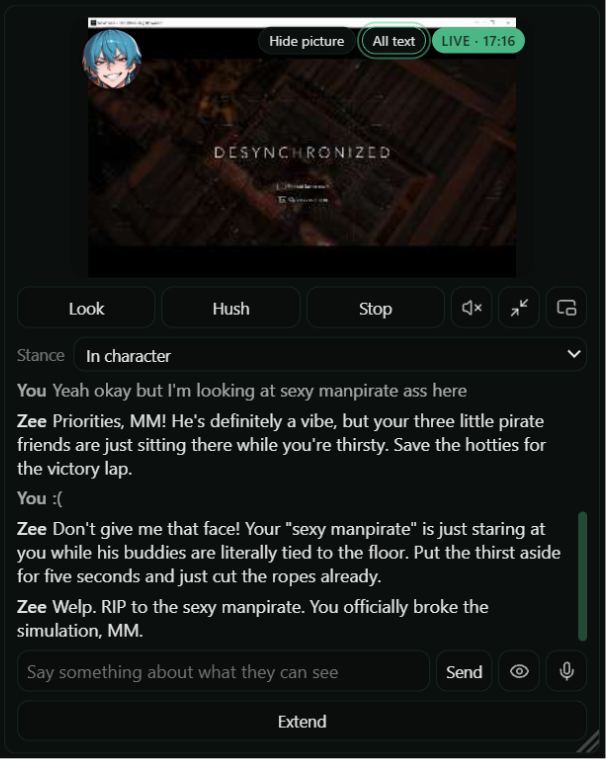
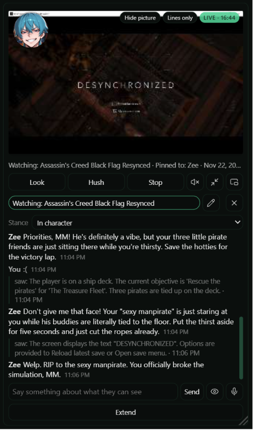

# Houselights

Your character lives in your chat. Now the house lights are up, and they can see out — your game, your screen, your terrible decisions — and react as it happens.

**The fourth wall had a good run.**



Houselights is an extension for [Lumiverse](https://github.com/prolix-oc/Lumiverse). Share a window, a
whole screen, a webcam shot or any picture, and the character in your open chat reacts to it. Every
reaction lands in your chat, so they remember the best (or worst) moments.

It's a spectator, not a player. It never touches your game. It just judges you.

> Houselights is an unofficial community extension. It is not affiliated with or endorsed by the
> Lumiverse project.

---

## How it works

Everything runs inside your browser, inside Lumiverse. There is no helper program and no server.

1. **You press Look** (or start a session). Your browser's own share dialog asks what to share. One
   frame is taken, shrunk to at most 1280 pixels on its long edge, and encoded as a JPEG.
2. **The eyes describe it.** In *describe* mode the frame goes to a vision-capable connection you
   choose, which writes a short, plain description — no jokes, just what's there; for a meme, a post
   or a chat it quotes the words, since they're the point. In *attach* mode the
   picture goes straight to the character's own model, if that model can see.
3. **The character reacts.** Houselights asks Lumiverse to build the prompt the way it always does —
   persona, character card, world info, memories, chat history — adds what was seen, and the reply
   lands in the chat. A hidden note records what was seen, with a small thumbnail under
   it, so you have a record of what was sent.

```
your screen / webcam / photo → [one frame, downscaled] → [vision model: what IS this]
                                                                       ↓
                        your chat ← [your character, via Lumiverse's own prompt assembly]
```

In a continuous session it looks every few seconds, ignores frames where nothing visibly changed,
rates whether the moment is worth a comment, and waits out a cooldown between reactions. The trick is
shutting up most of the time, so that when it does speak it's earned. During a **Hush** it keeps
watching without talking, so in *describe* mode the vision model still runs (and costs) while hushed.

## What it can see, and where it goes



Houselights only captures when you press a button or start a session, and only what you pick in your
browser's share dialog. Every capture is sent to the Lumiverse connection named next to the button —
nothing else, nowhere else. Houselights has no server, no telemetry and no network access of its own;
it runs inside your Lumiverse install, and the permissions it asks for are listed below with the
reason for each.

Captures are downscaled before sending. What stays in your chat is a hidden note with a small
thumbnail (320 pixels) of what was seen; the full-size frame is kept only if you turn on *Also keep
the full-size frame on the hidden note* in the settings. Your browser shows its own sharing indicator the
whole time a session is live, and sessions stop themselves after 30 minutes (adjustable up to 4 hours in Settings → Capture) unless you extend them.
Webcam photos are taken one at a time and the camera is released the instant the photo is taken. By
default the Lumiverse tab itself is hidden from the share picker.

Voice is off until you turn it on. The microphone opens only when you press the mic button and
closes after you finish speaking; Houselights never listens in the background. With Whistle, your
speech is transcribed on your own machine; with an STT connection it goes to that provider, and with
the browser's recognition it goes to the browser's speech service. Spoken replies use your Lumiverse
voice settings. A phone keeps its own recogniser choice, and phone browsers only allow the microphone
on `https://` pages.

Look-things-up is off unless you turn it on in the Coach stance. When on, Houselights searches with
your own Lumiverse web-search settings, using only the game or app name you confirmed and text printed
on screen, such as the current objective or the place name — never your screenshot or window title.

## Permissions

Lumiverse will ask you to approve exactly these seven. If it asks for anything else, don't install.

| Permission | Why Houselights needs it |
|---|---|
| `generation` | To ask your connections for a description and a reaction, and to list them for the pickers |
| `chats` | To know which chat you're looking at |
| `chat_mutation` | To put the reaction and the hidden note into that chat |
| `characters` | To read the character's name, so a stray name tag can be stripped from a reply |
| `ui_panels` | To draw the widget: a small floating window with the last frame and the newest reaction |
| `media` | Voice: speak replies aloud and push-to-talk, only when you turn them on |
| `web_search` | Look things up: notes about the game you confirmed, only in chats where you turn it on |

Not requested, on purpose: screen recording, system audio, images, a web proxy, event tracking.
`web_search` is a privileged permission: Lumiverse asks for it separately, and everything else works
without it.

**A window title never reaches the model without you seeing it first.** Some
browsers (Firefox) tell Houselights the title of the window you share, and titles can carry document
names, account numbers, usernames. Houselights shows it as a suggestion, "Watching: … ?", and sends
nothing until you say yes or edit it. The same goes for its own guess at what game or app is on
screen. A confirmed name lasts for the session: the next session asks "Still …?" before using it, and
so does a session in which the screen stops looking like it.

## Install

1. In Lumiverse, open **Extensions** and choose **install from URL**:

   ```
   https://github.com/MissusMeesecks/Houselights
   ```

2. Approve the seven permissions above.
3. Open a chat with the character you want doing the watching, open the drawer and find the
   **Houselights** tab (the popcorn icon).
4. Press **Look**, pick a window, and wait a few seconds.

The walkthrough, with what each control does, is in [`docs/install.md`](docs/install.md).

**Macs, Safari and iPhones are a beta:** Houselights was tested in Lumiverse's Android app and Chrome, Firefox, and Edge on Windows. What's known to
differ, and what to report, is in [the install guide](docs/install.md#on-a-mac-or-an-iphone-beta).

## Using it

- **Look** takes one frame and reacts. **Start** opens a session so Look needs no picker; in
  *continuous* mode a session also looks on its own every few seconds. **Stop** ends it; **Extend**
  adds time before the 30-minute auto-stop (the last two minutes show *Stops in m:ss · Extend* on the widget and the phone toolbar). A **LIVE** badge sits on the tab while a session runs.
- **Look** is also an input-bar action, so you can fire it without opening the drawer. With something
  typed in Lumiverse's chat box it becomes **Send + look**: a fresh Look, and what you typed goes with
  it as your message. The chat box empties only once your line is in the chat.
- **Other eyes:** a webcam snap, your phone's camera (the extension works over your LAN), or any
  picture from disk.
- **On a phone or tablet** the tab puts Other eyes at the top and hides what needs a computer (screen
  sharing, the next-track key, pop-out). The widget there is a small toolbar over the chat: reactions
  are read in the chat itself, like any message. It shows **Photo** (the camera app) and **Picture** (one
  from your files), **Hush**, the speaker, **?** and **Fold**, which folds it to a small popcorn you tap to bring
  it back. Tap **?** and then any button, and the toolbar says what that button does without doing it. Drag it where you like; it remembers, and moves up out of the way of the keyboard. **Hide
  widget**, at the top of the tab, turns it off. A photo or a picture is never told the game name from
  Watching: that name is about your screen.
- **Desktop companion** (on a phone, under During the show in the tab; on a computer, full settings → Mobile; off by default): play on your computer and reply from your
  phone, with the chat open there. The toolbar's **Look** button follows Lumiverse's chat box: empty, it reads
  **Look** and your computer takes a fresh look; with something typed it reads **Send + look** and sends that with the look.
  The same button is in the chat box's own menu, and Photo and Picture stay on the toolbar. If the chat open on the phone isn't the one Houselights is reacting in, the button says **Go to
  chat**. The computer's session must already be running, since only the computer can open the window
  share picker. This uses Lumiverse's chat box where Lumiverse offers it to extensions; on an
  older Lumiverse the button stays Look, and a pencil beside it opens a one-line box of its own.
- **React in this chat** is a per-chat switch. Reactions only land in chats you've turned it on for.
- **Stance** (per chat, in the tab or on the expanded widget; in a group chat, per viewer in the tab only): **In character** (the default) gives the character no act to put
  on, just what's on screen; **Heckler** mocks what it sees; **Coach** notices what you're doing and
  offers a pointer; **Custom** is an instruction you write, which
  you can name and save to reuse in any chat (in the Box Seat, each Custom viewer can have their own). Under every stance the character
  is told it's looking at your real screen and that if they appear on it themselves, they recognise it.
- **Hush** (input bar, widget, phone toolbar, and beside Stop in the tab): they keep watching, they just can't talk about it. The button
  counts down (*Hushed · 4:32*); click it again to let them talk. While hushed, nothing breaks through
  by default, and anything already being read aloud stops. Interesting moments still go into the chat
  as hidden notes (at most one per minimum gap), and the first thing they say afterwards is
  handed a short list of what they saw, so they can bring one up. When a hush you pressed ends
  (lifted or run out), they say one thing about the most interesting moment from it (Pacing has the
  switch; on by default). A Look or a line you send yourself still gets an answer, and the hush keeps running.
  When a session ends, by Stop or by itself, they say one closing line about it: the **curtain call**
  (Pacing has the switch; on by default; not after a session under two minutes, and not while hushed).
  It also goes quiet by itself for a moment after you speak in the chat; the widget's strip shows that
  one, not the button.
- **Talk back** from the expanded widget: type a line, press Enter, and the character answers it with
  what it last saw; the eye button takes a fresh look first. Your line is a normal message in the chat.
- **The Box Seat:** make the watched chat a **group chat** and its members sit in a box together. Each
  Look goes seat by seat: the opener speaks (the viewers take turns), then the next viewer is asked to
  answer them, and each line lands in the chat as its own message, carrying that character's own name
  and avatar on hosts that allow it (older hosts get a *Name:* prefix instead). Stances are per viewer.
  Talk back and @-name a viewer to make them open. With **Seat your council members too** on (settings),
  your Lumiverse council members can watch too. In a group chat they all join the box unless you untick
  them; in a solo chat, the ones you tick join the character, which makes that chat a Box Seat.
  On a council member's line, Lumiverse's big avatar is the chat's main character's, because the chat
  only draws characters, so Houselights puts the member's own small portrait beside their name; the
  widget shows it too.
- **Voice** (on hosts with Lumiverse's speech APIs): the speaker button on the widget reads each reaction
  aloud, one line after another. Each character speaks in the voice set on its **Voice** tab in
  Lumiverse's character editor, or your default Lumiverse TTS voice if it has none, so in a Box Seat
  every viewer allowed to speak can sound different. A council member has no character card, so it gets
  a **Voice** picker of its own in the tab's Box Seat section. Pick **Speaks aloud: Only <name>** to have
  just one viewer speak while the others stay on screen. With a pinned chat that isn't the one open on
  screen, reactions are still read aloud, but in your default voice: Lumiverse finds a character's voice
  only for the chat you're looking at. The mic button beside Talk back is push-to-talk: press, say one thing,
  and it's typed into the box for you to send (or, with *Send what the mic heard after a moment* on in
  the Voice settings, sent a few seconds later unless you stop it). Pressing the mic also
  silences the character. Nothing listens between presses.
- **Hide widget / Show widget** (the button at the top of the Houselights tab, on by default) shows or hides the widget.
- **Pop out on start** (the tab's *During the show* section, needs the widget): any Look button that starts a
  session — the tab's, the widget's, the input bar's — also opens the widget in its own always-on-top window.
- **Widget appearance** (folded inside the tab's *During the show* section): the size of the speaker's portrait on the
  widget's picture, how see-through it is, and the widget's text size.
- **Hide picture** and **Lines only** (the top-right corner of the widget's picture, one tap each; also in
  *During the show*): hide the last picture while keeping the portraits, and hide every line of text
  that isn't a character's or yours (what it's watching, progress, notes, what was seen). With the
  picture hidden, the top of the widget shrinks to the portrait.
- While a reaction is being written, the widget says what's happening on its own line (*Reading the
  picture…*, *Marlo is answering (2 of 4)…*), and in the Box Seat each line shows on the widget as it
  lands. Look waits until the reaction is done; one at a time.
- **Next-track key = Look** (the tab's *During the show* section, off by default, Chrome and Edge): while a session runs, your
  keyboard's next-track media key takes a Look, even with a game in front. To get the key, Houselights
  plays silence while the session runs, so Spotify and other players won't skip on that key until the
  session stops; the widget shows *⏭ = Look* while it's held. A press that can't take a Look says why on the status line.
  If another player is open and the key still goes to it, press the key and pick Houselights in the
  media pop-up your system shows (on Windows, the arrow at its edge switches between players). If the
  key stops answering mid-session, untick the box and tick it again.
- **Help**: each setting's explanation sits behind the small **?** beside it. Press it and the help
  opens in place, under the row; press it again to close it. Nothing depends on hovering, so it reads
  the same on a phone or tablet. Lumiverse's own help button on the Houselights tab's header opens a
  short guide for what doesn't fit beside a setting.
- **Deletes and resets ask first**: deleting a saved instruction or resetting a Custom instruction to
  the stock one opens Lumiverse's own confirm dialog.
- **Search** (top of the full settings): type a word and only the settings that mention it stay, with
  their help opened so you can see why they matched. Clear the box and everything is back as it was.
- **Permissions line** (top of the tab): your Houselights and Lumiverse versions and whether every
  permission is granted; a missing one is named with what stops working without it.
- **Look things up** (any stance, off by default, one switch per chat): the character gets a few notes from your own
  Lumiverse web search about the game you confirmed under Watching, searched with the objective, mission
  or place name printed on screen. No such text on screen, no search. One search per change of that
  text, not per Look. A Coach uses them to help; every other stance is told to use them only where
  they fit who the character is, and never to recite them. A Custom instruction needs no special
  wording to use them, though it can steer them. **It may spoil:** the notes can mention later
  areas, twists or endings, and the character may say so. A reaction that had notes in front
  of it is marked *had notes*, and the tab shows the last search and exactly what was given. Needs Lumiverse's Web Search set
  up, and vision set to *describe*.
- **Pin a chat** (Houselights tab, or **Pinned chat** in the settings): reactions keep landing in that
  one chat while you're elsewhere, and the tab shows how many are waiting, with a *You're here* /
  *You're elsewhere* badge beside Unpin. Unpin to follow whichever chat is open again. While you're
  elsewhere, reactions read aloud use your default voice, not each character's own.
- **Models:** two connection pickers in the full settings — one for the character's voice, one for
  the eyes.

**Where things are:** what you touch per session or per chat is in the Houselights tab (Session, Who
reacts, Watching, During the show, Last sent). What you set once is in the full settings under
**Settings → Extensions → Houselights**, one link away at the bottom of the tab: Models, Seeing,
Capture, Pacing, Voice, Box Seat, Pinned chat, Web search, Mobile (on a computer), Prompts and
Troubleshooting. A search box at the top finds any setting by a word in its name or its help. The full list is in [the install guide](docs/install.md#6-where-things-are).

## Which model

**Turn thinking/reasoning off.** A reaction is a line or two; a model that thinks first leaves you
waiting seconds for it, and some models (DeepSeek V4 Flash and Pro in testing, reasoning-only models like
DeepSeek R1) won't stop thinking — skip those. A fast model that can see images works best. **Gemma 4
31B** is recommended and is what Houselights is tested with; Gemma 4 26B A4B was occasionally poor at
following the prompt.

The eyes need a model that can see. In *describe* mode that can be a different, cheaper connection
than the one doing the talking.

## Scope — deliberately narrow

**In:** text reactions; opt-in voice (push-to-talk for you, spoken replies for them); screen,
camera and picture watching; pacing; callbacks through Lumiverse's own memory.

**Out, on purpose:** game control, mobile screen capture, always-on listening.

## Credits

- The name-prefix reading and the @-mention rule borrow from
  [Lumiverse-ChatRoom](https://github.com/prolix-oc/Lumiverse-ChatRoom), with thanks.
- Out-of-turn reactions follow the path
  [Lumiverse-CharacterNudges](https://github.com/prolix-oc/Lumiverse-CharacterNudges) opened.
- The popcorn icon and the settings cards' line icons are from [Lucide](https://lucide.dev) (ISC licence,
  Copyright (c) Lucide Contributors; portions Copyright (c) Cole Bemis, as part of Feather, MIT).

## Licence

[MIT](LICENSE).
